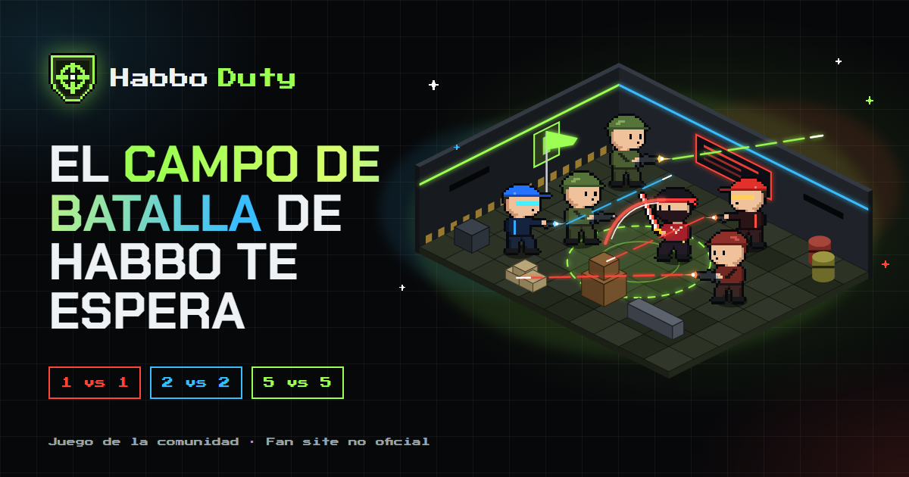

# Habbo Duty

Landing page de **Habbo Duty**, un juego de la comunidad de Habbo con salas clásicas convertidas en zonas de combate táctico: duelos **1 vs 1**, estrategia **2 vs 2** y guerras **5 vs 5** entre kekos con pistolas, rifles y espadas.

**Sitio publicado:** <https://habbo-duty.vercel.app>



> Fan site de la comunidad. No está afiliado, patrocinado ni aprobado por Sulake Oy ni por Habbo. Habbo es una marca registrada de Sulake Oy.

## Qué tiene

- **Navbar** fija con logo, enlaces a cada sección, botón "Jugar Ahora" y menú hamburguesa accesible en celulares.
- **Portada** con el título, los dos botones ("Unirse al Juego" y "Ver Mapas") y una escena de batalla en pixel art.
- **Modos de juego**: tres tarjetas interactivas (brillo que sigue al mouse y botón "Ver tácticas").
- **Mapas destacados**: Mapa de Guerra y Mapa de Japón en pestañas accesibles (con teclado).
- **Cómo empezar** en 3 pasos, bloque de **comunidad** (Discord y redes) y **código de honor**.
- **Pie** con el descargo legal y los enlaces.
- Página **404** propia.

Todo el arte (kekos, salas isométricas, íconos e insignia) es **propio**, dibujado con código en SVG. No se usa ningún recurso oficial de Habbo/Sulake. Las fuentes (Chakra Petch, Press Start 2P e Inter) tienen licencia SIL Open Font License y se sirven desde el propio sitio.

## Tecnología

Sitio **estático**, sin frameworks y con una sola dependencia de desarrollo:

| Parte | Cómo |
| --- | --- |
| HTML | Se genera en el build desde vistas en JavaScript con escape automático |
| Estilos | Tailwind CSS 4 **compilado** a un archivo `.css` (nada de CDN en el navegador) |
| Interacción | Módulos ES nativos, sin librerías |
| Arte | SVG generados con `npm run art` |
| Publicación | Vercel (cabeceras de seguridad en `vercel.json`) |

## Estructura (por capas)

```text
src/
  config/site.config.mjs   → configuración: enlaces, Discord, redes, hotel, URL del sitio
  content/*.json           → contenido/datos: textos de cada sección, modos y mapas
  views/                   → estructura: HTML de la página, una sección por archivo
  styles/main.css          → estilos: tema (colores, fuentes) y componentes
  scripts/                 → comportamiento en el navegador (menú, pestañas, tarjetas)
  lib/                     → utilidades seguras: escape de HTML, validación de enlaces y contenido
public/                    → imágenes, fuentes e íconos que se publican tal cual
scripts/build.mjs          → arma dist/
scripts/serve.mjs          → vista previa local con las mismas cabeceras que producción
tools/                     → generadores del arte (SVG) y de los PNG
tests/                     → pruebas (node:test, sin dependencias)
```

## Uso

Requisitos: Node.js 20 o superior.

```bash
npm ci
```

```bash
npm run build
```

```bash
npm run preview
```

La vista previa queda en <http://localhost:4173> y aplica las mismas cabeceras de seguridad (CSP, HSTS, etc.) que Vercel, así cualquier problema se ve antes de publicar.

Otros comandos:

| Comando | Qué hace |
| --- | --- |
| `npm test` | Corre todas las pruebas (incluye el build) |
| `npm run audit` | `npm audit` de las dependencias |
| `npm run check` | Build + pruebas + auditoría, todo junto |
| `npm run art` | Vuelve a dibujar los SVG de `public/assets/img/` |

## Cambiar enlaces y textos

- **Enlaces** (Discord, redes, hotel, URL del sitio): `src/config/site.config.mjs`. Un enlace vacío (`""`) se muestra como "Próximamente". Solo se aceptan enlaces `https://`; si ponés otra cosa, el build se corta y te dice qué corregir.
- **Textos**: los archivos de `src/content/`. En el título de la portada, lo que va entre corchetes `[así]` se resalta con el degradado neón.

Después de cambiar algo, `npm run build` (en Vercel se hace solo al publicar).

## Seguridad

Resumen (el detalle y la auditoría completa están en [SECURITY.md](SECURITY.md)):

- CSP estricta sin `unsafe-inline` ni `unsafe-eval`, todo desde el propio dominio, con Trusted Types.
- HSTS, `X-Frame-Options`/`frame-ancestors`, `X-Content-Type-Options`, `Referrer-Policy`, `Permissions-Policy` y aislamiento entre orígenes.
- Escape de HTML por defecto y validación de todos los enlaces en el build; nada de `innerHTML` en el navegador.
- Enlaces externos siempre con `rel="noopener noreferrer"`.
- Sin secretos en el repo, `.gitignore` y `.vercelignore` revisados, una sola dependencia fijada y auditada, sin scripts de instalación.

## Publicar en Vercel

El proyecto ya trae `vercel.json` (instala con `npm ci`, compila con `npm run build` y publica `dist/`).

```bash
vercel --prod
```

El CLI de Vercel no lee `.gitignore`: lo que se sube lo define `.vercelignore`.

Por ahora se publica con el CLI. Para que cada push a `main` se publique solo, hay que conectar el repositorio en Vercel → proyecto `habbo-duty` → Settings → Git.

## Accesibilidad

- Enlace "Saltar al contenido", HTML semántico y un solo `h1`.
- Menú, pestañas y botones con `aria-expanded`, `aria-selected` y manejo de teclado (Escape, flechas, Inicio y Fin).
- Contraste alto, foco visible y textos alternativos en todas las imágenes.
- Respeta "reducir movimiento" del sistema y funciona sin JavaScript.

## Licencia

Código y arte: [MIT](LICENSE) © Luciano Colalunga. Fuentes: SIL Open Font License 1.1 (ver `public/assets/fonts/`).
